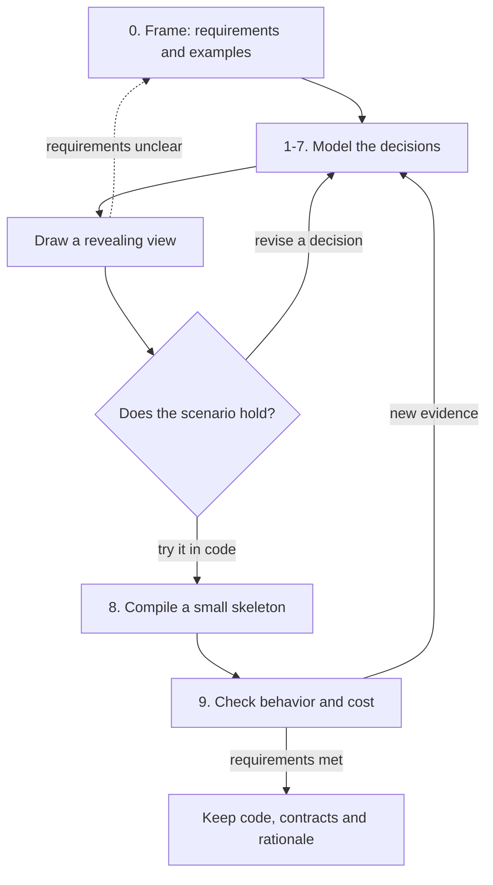
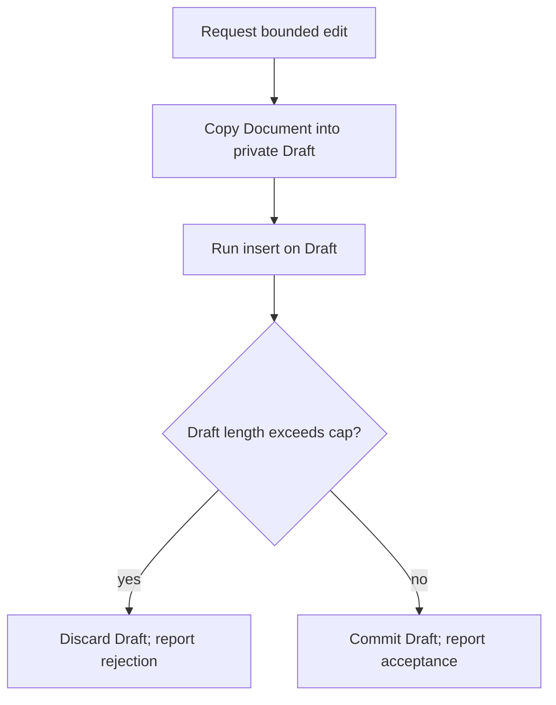
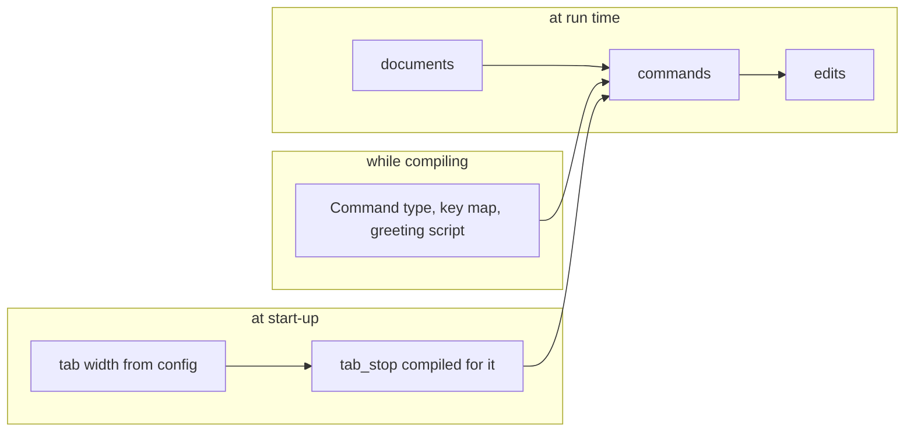
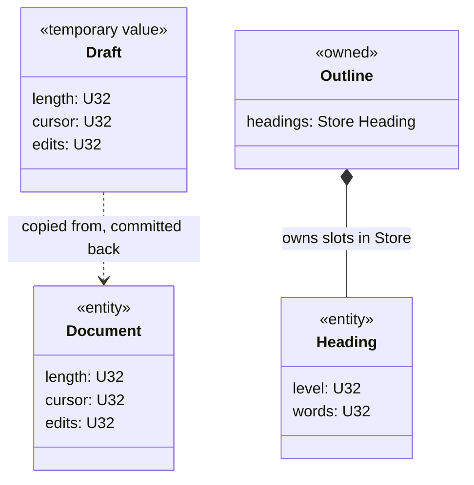
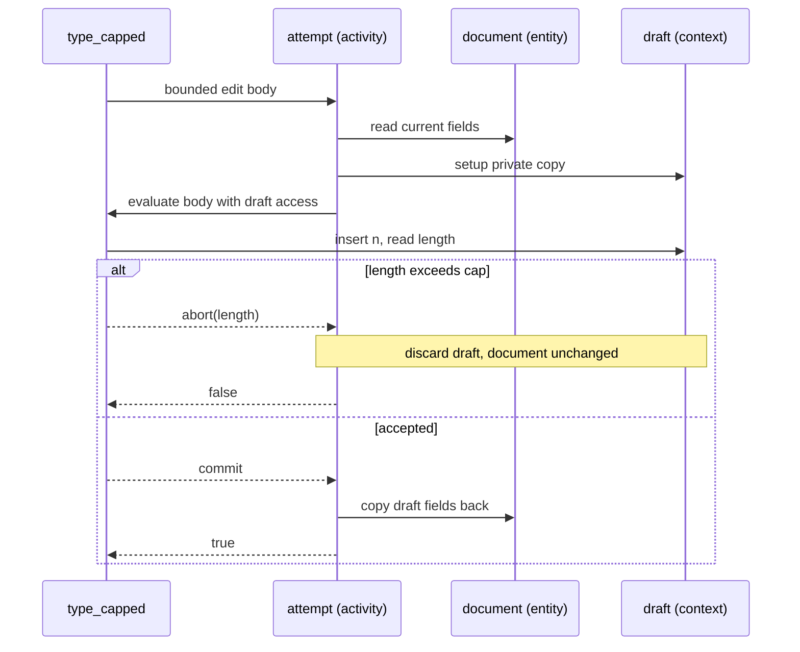
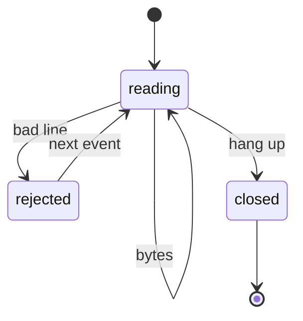
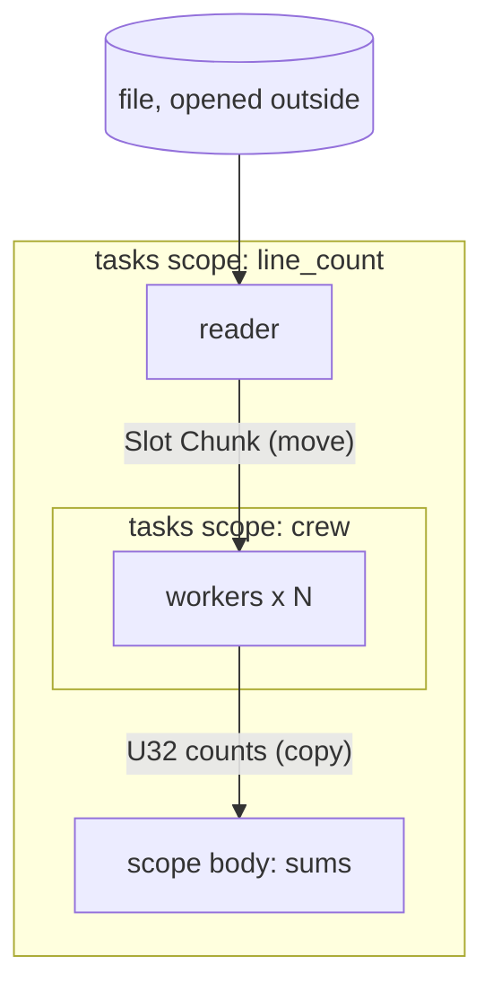
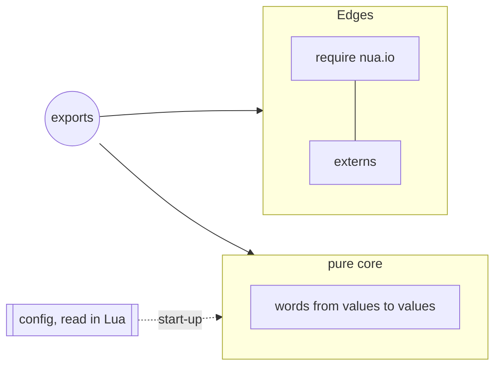

# Designing and writing Nua

**Status: a guide to designing and writing programs in Nua, beside [the language](syntax.md) and [the compiler](architecture.md), which own the rules.** It follows Let's guide, *Designing and writing Let*, and keeps what transfers. Where Nua differs, it says how and why.

This guide is about discovering a good program, not deriving one mechanically from the language's philosophy. Nua's mechanisms inform the questions (§1); requirements, diagrams, experiments and code help answer them. Its centre is the **activity**: bounded work with someone responsible for setup and completion. Inside an opened context, an **instruction** is a call without a receiver (§6). The same composition, run while compiling, builds descriptions and types (§6.10).

* **Part I** is a design process: ten questions to revisit as the design develops, with diagrams that help expose decisions and a small worked investigation.
* **Part II** is about writing words.
* **Part III** is house style.

Every `lua` block below is an excerpt of [`examples/guide.nua`](../examples/guide.nua), which the test suite compiles to strict C and runs; every `c` block is that compilation's actual output. `tests/guide.lua` checks these correspondences, not the prose's claims or the quality of the design. The blocks follow the current source style (§21). Diagrams use Mermaid to draw UML-style and dataflow views; their notation is explained where it is first used.

## 0. Forms this guide relies on

| Form | Used for |
|---|---|
| `local f = do(x: T): R ... end`, `do(x: T): R = e` | typed words: compiled to native code |
| `function T:m(...): R ... end` | methods: the receiver is `self`, a reference |
| `struct { ... }`, `oneof { ... }` | records and sums |
| `s { name = do(p) ... end, name(p) = e }` | matching a sum: one handler per alternative |
| untyped parameters, `f known` | compile-time parameters, partial application |
| `f "lit"`, `f 1 2`, `f x do ... end` | literal application and saturating chains |
| `do(ctx..)`, `do(..)`, `local ctx.. = e` | opening a record or a vocabulary; `do(..)` leaves it unnamed |
| `insert n`, `note 1` inside an opened block | instructions: calls the innermost opened receiver resolves (§6.3) |
| `keymap do(..) bind "h" (...) end` | a builder: an activity run while compiling that returns a description or a type (§6.10) |
| `endall` | closing a spine of trailing blocks |
| `s[id]`, `g[i]`, `pool[slot]`, `a[i]` | checked places |
| `tasks do(scope..)`, `spawn do`, `first_of` | concurrency |
| `require "nua.io"` | libraries, including I/O by completion |
| `native word`, `nua run` | compile now, into this process, and call from Lua |
| `call f x` | one site as a shared C function, for code size (§11.2) |
| `T.__index`, `T.__add`, `T.__cast`, … | type hooks: what `x[k]`, an operator or a conversion means on a type |

---

# Part I — Designing

## 1. The stance

Nua puts **binding time** at the center of computation. A program is Lua that runs while compiling. Typed words are evaluated in place with whatever is known; unknown work and observable native effects remain as C. Let's question, "what is known, and when?", has an exact answer for every value in a Nua program:

* **A Lua value** (a table, a string, a closure, a number in host code) exists only while compiling.
* **A known native value** (`U32 4`, a constant field, a sum with a known tag) is computed while compiling. It shapes the C, and may vanish from it.
* **A runtime value** (a parameter of an export, a read from a file) is in the C.

These language properties make certain design practices especially useful. They do not choose the domain model or activity boundaries for you:

| Principle | What it asks of you |
|---|---|
| **Binding time is the centre.** Pure known work can run while specializing. | Preserve known descriptions (§3); an engine over a known description can lose its interpreter (§17). Choose optional start-up compilation deliberately. |
| **A word is evaluated in place.** Ordinary application needs no runtime closure or call boundary. | Write words at the size the meaning wants (§15). Activities add no callback dispatch, but their work and storage may remain (§6). |
| **Ownership is lexical.** Scopes own values; stores own slots. | Identify owners and distinguish identity from borrowed access (§5); make each borrow's valid lifetime clear. |
| **The residual work is inspectable.** Generated C exposes operations and calls to mechanisms. | Read the C (§11.1); inspect reached library/runtime code when needed, and state costs, failures and lifetimes in contracts. |
| **Tasks share nothing.** Values cross by copy, buffers by move. | Draw concurrency as owners and messages, never as shared state (§8). |
| **Grow the vocabulary, not the language.** Libraries and the runtime are Nua words; configuration, dialects and tests are Lua. | Say a domain as a vocabulary of words and instructions (§6.9, §6.10); a new macro is a last resort. |
| **Names carry the reading.** Opening contributes fields and vocabulary; bare calls can resolve receiver methods. | Speak in instructions that read as sentences (§19); understand shadowing, and qualify a name when the subject would otherwise be unclear. |

## 2. The process

Start with the job, then investigate the questions below. The numbered steps give a useful first route, not independent gates. A completion rule can change ownership; a task boundary can turn a borrow into a message; an outcome can expose a missing state. Revisit the affected question as soon as that happens, not only after testing.



| Step | Question | Useful working view | Ready to try in code when |
|---|---|---|---|
| 0. Frame | What is the job? | inputs, outputs, scale, failures, constraints; actor/use-case sketch | success and unacceptable outcomes have concrete examples |
| 1. Binding times | What is known when? | availability and change frequency in lanes | known information has a path to its use; specialization choices have a reason |
| 2. Values and outcomes | What does the program talk about? | records, sums and example values | alternatives, payloads and caller decisions are explicit |
| 3. Ownership | Who owns what, and what is each relationship? | class/ownership diagram with labelled arrows | mutable storage has an owner and borrowed access has a valid lifetime |
| 4. Activities | What bounded work happens, and what is said inside it? | sequence and activity diagrams; context vocabulary | setup, normal completion and rejection each have a responsible participant |
| 5. States | What has a lifecycle? | state diagram or state/event table | legal transitions and invalid combinations are accounted for |
| 6. Concurrency | What runs at the same time? | tasks, messages and enclosing scopes | transfers, shutdown and failure paths can be followed without shared mutation |
| 7. Composition and edges | Who connects the parts, where does the world come in? | component/dependency diagram | effects are located and domain decisions can be tested independently |
| 8. Skeleton | Does it hold together? | one end-to-end scenario in code | it compiles and exercises the important contracts, including rejection |
| 9. Verify | Does it behave and cost what we said? | tests, generated C and measurements | step 0's requirements are met, or the next revision is identified |

### 2.1 Draw to discover

Diagrams are working tools, not illustrations to produce after deciding everything. Choose the view that makes the uncertain relationship visible:

| View | Question it makes concrete |
|---|---|
| use-case view | Which actor needs which result, and what lies outside the system? |
| sequence diagram | Who sets up, who calls whom, who receives the outcome, and who still owes completion? |
| activity diagram | Where does work branch, repeat, join or stop? |
| state diagram | Which events are legal now, and what state does each outcome leave? |
| class/ownership diagram | What persists, what is temporary, and which relationships own, name or borrow? |
| component/dataflow view | Where are the effects, task boundaries and messages? |

**A UML activity is not automatically a Nua activity.** UML shows a flow of behavior. A Nua activity gives bounded work a setup and a completion responsibility. One flow may reveal several composed activities; a sequence diagram often reveals their boundaries better than a single activity box.

Walk a successful scenario and a rejected or failed one through the drawing. Label the arrows with actual values, instructions or outcomes. An arrow called only "uses" usually hides the decision you need to make. Keep each view focused; split an unreadable drawing by concern rather than omitting the difficult path.

### 2.2 A worked frame: a bounded edit

**The job.** A caller asks to insert `n` units into a document with a length cap. An accepted edit increases length, advances the cursor and records one edit. A rejected edit leaves all three fields unchanged and reports rejection. The document persists; tentative work does not. This is a small, in-memory operation on three counters, with no I/O or concurrent mutation. Assume the cursor starts within the document and all additions fit `U32`; a general text editor would need an explicit overflow and storage-capacity contract too.

A first proposal is to call `insert` on the document, then test its length. Drawing the rejection path exposes the problem: the document has already changed. We could undo each write, but that gives every new instruction another rollback obligation. Instead, revise ownership: keep a private `Draft`, run the instructions there, and copy it back only on acceptance. This discovers the `attempt` activity (§6.6), rather than assuming a transaction because transactions are a familiar pattern.



*This activity diagram is a behavior view: boxes are work, the diamond is a decision, and the two exits are distinct completion paths. The implementation uses a body outcome to choose them.*

Now revisit the other questions. The count and cap may be runtime inputs; making the cap a compile-time parameter is not required. The body needs `commit` or `abort` with the rejected length, while this caller needs only a `Bool`. There is one document owner and no concurrent work, so a task diagram adds nothing here. The sequence diagram in §6.1 will make the participant responsibilities explicit; §6.6 supplies the implementation; §11 returns to acceptance and rejection tests. The other examples show decisions this small frame does not need: persistent IDs, lifecycle states, builders and task groups.

### 2.3 Revisit and record

Symptoms suggest questions, not automatic diagnoses:

* **A hot path interprets configuration:** revisit binding times. Is the description available earlier, and would specialization repay its cost?
* **Two places want to change the same thing:** revisit ownership and activities. Is this sequential borrowed access, a persistent identity, or a task message?
* **A body repeatedly reaches around its context:** revisit the vocabulary. Is a verb missing, or are two purposes mixed?
* **A match has a "cannot happen" arm:** revisit state and outcome modeling. Is a state missing, or does the representation admit an invalid combination?
* **Tasks need a lock or shutdown guesses:** revisit the owner task, message protocol and enclosing scopes.

Focus on one question while keeping assumptions about the others visible. Draft calls top-down to discover the vocabulary, then arrange executable Lua/Nua bindings in valid lexical order (§10). Compile a small scenario before filling in every operation.

Once code exists, use it as the authority for implemented structure. Keep requirements, completion contracts and consequential rationale alongside it: they explain what code must preserve and why. Retain diagrams that still answer a useful question, updating or deriving them where practical. Inspectable Lua types and words can support tooling, but they do not automatically recover design intent.

## 3. Step 1: binding times

Start by separating when information becomes available from how often it changes. These four lanes are a useful view of an interactive program, not four distinct compiler binding times:

| Lane | Examples | Becomes |
|---|---|---|
| **source** (while compiling) | record types, a key map, a protocol, limits | Lua values and descriptions |
| **start-up** | a config file, command-line flags, a schema, a file's header | runtime inputs, or descriptions specialized on with `native` |
| **steady state** | documents, connections, user data | runtime values |
| **per event** | a keystroke, a request, a line | runtime values, the hot path |

Preserve information already known while compiling: pass a Lua table, a known native value or an untyped parameter where appropriate. For start-up information, choose whether to keep it as runtime data or compile a specialization in the hosting Lua process. Availability makes specialization possible; reuse, code size and compilation cost decide whether it is worthwhile.



*Lanes show availability and use. The source descriptions shape command handling; the start-up arrow shows the optional choice to compile a tab-stop word for the configured width.*

**Start-up is a binding time.** `native word` compiles a word into this process and returns it as a Lua function, so a value read at start-up can be specialized on like a table written in the source: `native(tab_stop { tab_width = width })`. Keep the reading in Lua and the work in words; the same words compile ahead of time.

**Where specializing pays.** Look first at **data that drives control flow**: programs, grammars, schemas, protocols, key maps and state machines. A known scalar can simplify an expression; a known description can remove an interpreter. Neither guarantees a speedup for the complete program. Measure compilation cost, generated size, expected reuse and runtime work on the actual workload before choosing start-up specialization (§11).

## 4. Step 2: values and outcomes

### 4.1 Values first

Use scenarios to find the values: what must be stored, replayed, logged, undone or tested independently of the action that produced it? Model those things as data, and revise the records and sums as their behavior becomes clearer:

```lua
local Direction = oneof { left: Unit, right: Unit }
local Command = oneof { move: Direction, insert: U32, undo: Unit, quit: Unit }
```

Commands as data give replay and tests a shared input, and (§17) they give specialization something to work with. Undo also needs enough history to reverse an operation; naming an `undo` command alone does not provide it. In this guide, `Document` tracks counts rather than actual text or undo history.

### 4.2 Outcomes and failures

Use a sum when alternatives carry different data or require distinct handling, and match it exhaustively. A predicate can return `Bool`; a named sum makes a richer protocol explicit. Do not encode absence as a magic value:

```lua
local Found = oneof { found: U32, missing: Unit }
```

```lua
local find_nonzero = do(xs: Slice U32): Found
    local i: U32 = 0
    while i < xs.length do
        if xs[i] ~= 0 then
            return Found.found i
        end
        i = i + 1
    end
    return Found.missing()
end
```

The libraries follow the same rule: a receive is `oneof { value: T, closed: Unit }`, and a read/write I/O result is `oneof { done: U32, failed: I32 }`. In the bounded edit (§2.2), the body returns a `commit`/`abort` sum so completion can choose a path; the outer caller receives `Bool` because it needs only acceptance or rejection.

**Which kind of failure is which:**

| Situation | Expressed as | Example |
|---|---|---|
| alternatives need distinct handling or payloads | a sum | `missing`, `closed`, `failed(errno)` |
| an invariant is broken | a trap, at run time | an index out of range, a stale `Id`, a send on a closed channel |
| it is wrong while still known | a compile-time error | `index-range` on a known index, `signed overflow in +` |
| the world refused | an I/O outcome sum | `failed(e)`, `timed_out` |

A compile-time error is reported even in an arm that dynamic control may never reach. Guard such arms with a condition the compiler can see, or keep the value unknown there.

## 5. Step 3: ownership

### 5.1 Roles and relationships

**Distinguish domain roles from storage and binding time.** These labels answer different questions and can overlap: the document is an entity in the design, but its small record representation is copyable. A description can itself contain known native values.

| Role | What it is | Nua forms |
|---|---|---|
| **value** | copied freely; owned by whoever holds it | `struct`, `oneof`, `Array`, `Chars n` |
| **entity** | has identity across operations; independently recyclable entities can live in a store | a scope-owned record, or a struct in a `Store T` named by an `Id` |
| **owned** | resizable storage, created in place, accessed through `Ref`, not copied or moved by value | `Store`, `Grow`, `Text`, `Map`; a struct holding one (a ring buffer) |
| **view** | a window on someone else's storage, valid within its owner's lifetime and borrowing rules | `Slice`, `Str` |
| **handle** | a small name for runtime-owned state; transfer rules depend on its kind | `Chan`, `Pool`, `Slot` |
| **description** | known while compiling; shapes the code | a Lua table, a known value |

**Label storage and communication relationships explicitly:**

| Arrow | Meaning | Nua form |
|---|---|---|
| **field** | owns | a struct field (trees are fields) |
| **name** | identifies without owning | an `Id T` (graphs are stores) |
| **borrow** | uses for a valid bounded lifetime | a `Ref T` parameter, or borrowed access supplied by an activity |
| **message** | crosses a task boundary | a channel (copies) or a pool slot (moves) |

These labels prevent a vague UML association from hiding ownership. Add other domain dependencies when useful, but do not mistake them for storage edges. Use a `oneof` for alternatives where a class hierarchy would otherwise encode variants; shared behavior can be a vocabulary of words rather than inheritance. A reference may be returned from a received reference when its owner's lifetime permits it; a reference to temporary activity-owned storage cannot escape with it. Persistent identity may need an `Id`, and task boundaries need messages.



*The filled diamond denotes ownership; the dashed arrow denotes a dependency, not a borrow. The draft copies fields: it does not retain a reference to the document. The activity borrows the document while it coordinates setup and completion. An `Id Heading` names a store slot without owning it.*

### 5.2 The rules

* **Give mutable state one owner.** A scope owns its locals; a struct owns its fields; a store owns its slots. Other code receives access explicitly, as a `Ref`.
* **Trees are fields; graphs are stores.** A `Store T` holds objects with stable identity, and an `Id T` names one without owning it:

```lua
local Heading = struct { level: U32, words: U32 }
local Outline = struct { headings: Store Heading }

local add_words = do(outline: Ref Outline, id: Id Heading, n: U32): U32
    outline.headings[id].words = outline.headings[id].words + n
    return outline.headings[id].words
end
```

  `outline.headings[id]` is a place, checked at every use. Nothing holds its address past the stretch it was found in, so the store may grow between two uses.
* **A name is not the thing it names.** A `Ref` provides borrowed access; an `Id` identifies a slot without owning it. Sending a pool `Slot` transfers ownership: copying its bits does not duplicate permission to use the buffer.
* **Aggregates hold no references.** A struct cannot contain a `Ref`, a `Slice` or a `Str`; long-lived relationships are `Id`s.
* **Lua tables are for compile time.** Open, dynamic data is a Lua table while compiling. At run time, data has a shape.

## 6. Step 4: activities

> **Entities own what persists. Activities own or borrow what is needed for a purpose. Words express what happens inside.**

An activity is a design role made of ordinary parts: a word that sets up a context, runs a body that opens it, and owns completion. The callback is evaluated in place, so there is no runtime closure or callback dispatch. The context's storage and the work done through it remain when needed; private known state may fold away.

**The activity is the centre of this design method.** Look for bounded responsibilities: a working copy and its commit, a file and its close, a guarded iteration (`m:each do(k, v)`), a `tasks` scope and its join, a `blocking` call. Inside an activity you speak **instructions**: calls written without a receiver, which the opened context resolves (§6.3). The same construct, run while compiling on a vocabulary, is a **builder** (§6.10). Design the activities, and the program's shape follows.

### 6.1 Finding activities

**Walk a use case; look for work that must belong together.** One use case may compose several activities, and the same activity may serve several use cases. Ask:

1. **What persists?** Which entity or resource exists before and after this work?
2. **What must succeed together?** Which changes must be committed or discarded as a unit?
3. **What access is temporary?** Which borrow, working copy or acquired resource is valid only during this work?
4. **What must happen afterward?** Who commits, discards, closes, releases or reports each ordinary outcome?
5. **What does the body need to say?** Which instructions belong to this responsibility, rather than to every use of the entity?

In the bounded edit, the all-or-nothing requirement discovers a private draft (§2.2). The activity owns copying and conditional commit; the body needs `insert`, `length` and an outcome. Drawing the rejected path tests whether that division is complete:



*Participants are responsibilities, not threads. Solid arrows are calls or reads/writes; dashed arrows return outcomes. The `alt` frame makes both completion paths visible. The body is evaluated in place: these arrows do not imply runtime callback dispatch.*

**Put purpose-specific verbs on the context.** `Draft:insert` belongs to tentative editing; basic document operations may still belong on `Document`. A free activity word lives beside the entity without collecting every use case into its methods. The division is a design responsibility, not access control: fields remain public (§18.1).

### 6.2 Kinds of activity

| Kind | Setup | Completion | Example |
|---|---|---|---|
| working copy | copy the entity into a context | commit, or conditionally discard | `transaction`, `attempt` |
| in place | open a place | nothing; writes went through | `local node.. = g.nodes[id]` |
| scoped resource | acquire | release | `with_file` |
| accumulator | create the state | return a result from it | `counting` |
| policy | nothing, or a measurement | record, check, clamp, retry | `counted`, `clamped` |
| builder | a vocabulary | return a description or a type | `keymap`, `ui.component` (§6.10) |

### 6.3 Enter an activity and speak its instructions

```lua
local Draft = struct { length: U32, cursor: U32, edits: U32 }

function Draft:insert(n: U32): Unit
    self.length = self.length + n
    self.cursor = self.cursor + n
    self.edits = self.edits + 1
end
```

```lua
local type_word = do(document: Ref Document, n: U32): U32
    local moved: U32 = 0
    transaction document do(..)
        insert n
        local before = cursor
        move_left
        moved = before - cursor
    end
    return moved
end
```

`do(..)` opens the context without an unused receiver name. Bare calls use its methods (`insert n`, `move_left`), and its fields are live places (`cursor`).

`insert n` and `move_left` are **instructions**: calls without a receiver, resolved by the innermost opened context that provides the member, subject to lexical shadowing. A name the context lacks can fall through to enclosing contexts (§6.8), and later local declarations can shadow introduced names. The local binding and assignment are ordinary computation alongside those instructions. Open the context with a name (`do(draft..)`) when the receiver itself is needed, for example to qualify a member that something closer shadows.

### 6.4 Open to work; bind to remember

An opened field name is the field's place: reading it reads the current value. A binding takes the value at that point: `local before = cursor` keeps the cursor from before the `move_left` instruction. Opening a place keeps it a place: `local node.. = g.nodes[id]` works on the store's slot itself.

### 6.5 The activity owns completion

```lua
local transaction = do(document: Ref Document, body): Unit
    local draft = Draft { ..document }
    body(Ref draft)
    document = Document { ..draft }
end
```

This one commits a working copy at the end. Its contract is its own: write through, commit, roll back, retry. Three boundaries hold:

* the body's `return` leaves the body, not the activity;
* cleanup and commit are the activity's code, not a side effect of opening;
* access to activity-owned temporary storage cannot escape its lifetime; ordinary copyable results may leave, and a reference derived from received storage follows that storage's lifetime. An owner is returned like a value: it is built where the caller keeps it.

There is no callback call or runtime closure. The working copy does remain here: the C contains a local draft, its updates and the field copies back to the document. This is the cost of the chosen completion policy, not activity dispatch:

```c
uint32_t type_word(Document *document, uint32_t n) {
    Draft draft;
    draft.length = document->length;
    draft.cursor = document->cursor;
    draft.edits = document->edits;
    draft.length = draft.length + n;
    draft.cursor = draft.cursor + n;
    draft.edits = draft.edits + 1u;
    uint32_t before = draft.cursor;
    if (draft.cursor > 0u) {
        draft.cursor = draft.cursor - 1u;
    }
    uint32_t moved = before - draft.cursor;
    document->length = draft.length;
    document->cursor = draft.cursor;
    document->edits = draft.edits;
    return moved;
}
```

### 6.6 The body decides; the activity completes

A body cannot leave its activity, so it cannot abort by jumping out. **It returns an outcome, and the activity matches on it to choose its completion:**

```lua
local Outcome = oneof { commit: Unit, abort: U32 }

local attempt = do(document: Ref Document, body): Bool
    local draft = Draft { ..document }
    local committed: Bool = body(Ref draft) {
        commit() = true,
        abort(reason) = false,
    }
    if committed then
        document = Document { ..draft }
    end
    return committed
end
```

```lua
local type_capped = do(document: Ref Document, n: U32, cap: U32): Bool
    return attempt document do(..)
        insert n
        if length > cap then
            return Outcome.abort length
        end
        return Outcome.commit()
    end
end
```

```c
bool type_capped(Document *document, uint32_t n, uint32_t cap) {
    Draft draft;
    draft.length = document->length;
    draft.cursor = document->cursor;
    draft.edits = document->edits;
    draft.length = draft.length + n;
    draft.cursor = draft.cursor + n;
    draft.edits = draft.edits + 1u;
    if (draft.length > cap) {
        goto L1;
    }
    bool r = true;
    goto L2;
L1:;
    r = false;
L2:;
    if (r) {
        document->length = draft.length;
        document->cursor = draft.cursor;
        document->edits = draft.edits;
    }
    return r;
}
```

The rule "the activity owns completion" covers the body's ordinary outcomes too: the body says what happened, and the activity decides what that means for the entity. The outcome type is part of the activity's contract, so give it outcome names (`commit`, `abort`, `retry`), not unexplained flags. An outcome protocol is not exception unwinding: a trap is not an `abort` return, and opening a context does not install automatic cleanup.

This completes the bounded-edit design begun in §2.2. `abort` carries the tentative length to the activity; `attempt` deliberately projects that richer outcome to acceptance or rejection. A caller that needs the reason would need a richer outer result. Test both paths: successful commit changes the document, while rejection must preserve length, cursor and edit count.

Match the body's outcome at the call when completion needs it immediately. Known-tag returns can jump directly to their handlers, without a temporary tagged sum. This preserves effects and payload joins; it does not let a nested call steal the body's completion or remove an explicit native boundary. Keep an outcome in a local when the program genuinely needs to carry it elsewhere.

### 6.7 Stack activities instead of adding options

Each policy is its own activity, and the order of the spine is the order of completion:

```lua
-- a policy that completes after the work inside it
local clamped = do(document: Ref Document, max: U32, body): Unit
    body
    if document.length > max then
        document.length = max
        document.cursor = max
    end
end

local import_capped = do(document: Ref Document, stats: Ref Stats, n: U32): Unit
    counted stats do
    clamped document 100 do
    transaction document do(..)
        insert n
    endall
end
```

The transaction commits first, then the clamp applies, then the count is recorded, exactly as the spine reads from the inside out. `endall` closes the spine; it adds no semantics.

### 6.8 Nesting composes

Nested activities do not need to know about each other. A name the inner context lacks falls through to the enclosing ones, innermost first, so a block can speak to several activities at once:

```lua
-- nested activities compose: a name the inner context lacks reaches the outer one
local Log = struct { notes: U32 }

function Log:note(count: U32): Unit
    self.notes = self.notes + count
end

local logged = do(body): U32
    local log = Log { notes = 0 }
    body(Ref log)
    return log.notes
end

local type_logged = do(document: Ref Document, n: U32): U32
    return logged do(..)
        transaction document do(..)
            insert n
            note 1
        end
    end
end
```

`insert` is the draft's; `note` is not, so it reaches the log. The private log receives a known increment and never escapes, so its storage disappears and the result is a constant. The draft still has runtime fields:

```c
uint32_t type_logged(Document *document, uint32_t n) {
    Draft draft;
    draft.length = document->length;
    draft.cursor = document->cursor;
    draft.edits = document->edits;
    draft.length = draft.length + n;
    draft.cursor = draft.cursor + n;
    draft.edits = draft.edits + 1u;
    document->length = draft.length;
    document->cursor = draft.cursor;
    document->edits = draft.edits;
    return 1u;
}
```

If the draft also had a `note`, the draft's would win: the innermost context always does. Shadowing is how nesting works, so use it on purpose. When an override would hide something the block needs, the outer name is too generic, or the two activities should not be nested.

### 6.9 Design the context's vocabulary

The context type is the vocabulary of its block. Design it the way you would design a small language for that purpose:

* **Verbs for what happens**, as methods: `insert`, `move_left`, `note`. Put invariant-preserving changes behind these verbs; public fields do not enforce that discipline for you.
* **Fields for what the block reads**: `cursor`, `length`. If callers repeatedly need to change a field directly, ask which operation is missing. Document which representation fields only the vocabulary should write.
* **One context per purpose.** Repeatedly reaching around a context suggests a missing verb or mixed responsibilities (§2.3). Ordinary local computation and deliberate calls to other words are not forbidden.
* **Outcomes for how it can end** (§6.6), named for what happened.
* **Names that read in the block**: an instruction is read without its receiver, so `insert n` must say everything `draft:insert(n)` said.

### 6.10 Builders: activities while compiling

A **builder** is an activity whose context is a vocabulary, a Lua table, and whose completion returns a description or a type. Each invocation runs while the program is built: the block's instructions declare things, and the builder collects them. There is no runtime builder dispatch; the description and any words or values it retains may shape the residual program. Opening supplies the vocabulary without a current-builder global or an interface argument on every instruction.

```lua
-- a builder: the block declares, the builder returns a description
local keymap = function(body)
    local bindings = {}
    local vocabulary = {
        bind = function(key)
            return function(command)
                bindings[#bindings + 1] = { code = key:byte(), .command }
            end
        end,
    }
    body vocabulary
    return bindings
end

local editor_keys = keymap do(..)
    bind "h" (Command.move(Direction.left()))
    bind "l" (Command.move(Direction.right()))
    bind "u" (Command.undo())
end

-- the engine over the description: one test per binding, each command folded
local on_key = do(document: Ref Document, key: U8): Unit
    for _, binding in ipairs editor_keys do
        if key == binding.code then
            apply document binding.command
        end
    end
end
```

The description is known, so the engine (`apply`, §17) dissolves into one test per binding:

```c
void on_key(Document *document, uint8_t key) {
    if (key == 104u) {
        if (document->cursor > 0u) {
            document->cursor = document->cursor - 1u;
        }
    }
    if (key == 108u) {
        if (document->cursor < document->length) {
            document->cursor = document->cursor + 1u;
        }
    }
    if (key == 117u) {
        document->edits = document->edits + 1u;
    }
}
```

What a builder's vocabulary offers, and how to design one:

* **Declarations** create named parts, often as nested builders with blocks of their own (`button "save_button" do(..)`).
* **Properties** set a value on the current part (`px 4`, `caption "Save"`). Instructions run in order, so **a later setting wins**: no merge rules or priorities are needed.
* **Variants** are nested blocks that record conditional settings (`hover do(..) bg blue_700 end`).
* **Tokens** are names for known values, opened with the vocabulary (`md`, `red_600`); give them a kind so a wrong argument is an error at its line.
* **Sharing** is a block applied to the current part (`use primary`).
* **Nesting composes** exactly as in §6.8: a name the inner part lacks reaches the enclosing one.
* **Keep builders pure** (§9.3): they build descriptions; engines, which are words, do the work.

A builder is "describe, then run" (§17) with a syntax that reads like the domain. The UI library is the full example: a component is declared with a builder, its events become a sum, and its layout, routing and drawing are generated over the known tree ([UI components](ui-components.md), [UI style](ui-style.md)).

## 7. Step 5: states

For a lifecycle with distinct modes, draw the legal transitions before choosing its representation. Label events, state what each transition preserves, and decide what happens to events that are not accepted in the current mode:



A `oneof` is a natural representation when states carry different data. A word from state and event to next state makes the transition rules testable while compiling. Here `rejected` deliberately consumes the next event only to reset; even a `hang_up` in that state resets rather than closes. That is this example's policy, not a consequence of using sums:

```lua
-- a lifecycle as a sum, and one word per transition
local Conn = oneof { reading: U32, rejected: U32, closed: Unit }
local Event = oneof { bytes: U32, bad_line: Unit, hang_up: Unit }

local step = do(c: Conn, e: Event): Conn = c {
    reading(n) = e {
        bytes(k) = Conn.reading(n + k),
        bad_line() = Conn.rejected n,
        hang_up() = Conn.closed(),
    },
    rejected(n) = Conn.reading 0,
    closed() = Conn.closed(),
}
```

```lua
assert(host(buffered_after(U32 4)) == 7)
```

* **Match sums exhaustively, and account for every state/event combination.** A "cannot happen" arm is a prompt to inspect the model: a state may be missing, or separate fields may admit combinations that should be one variant. Not every counter or independent condition needs a state variant.
* **Test transitions, not just arithmetic.** Include every state and the events that are ignored, rejected or terminal. For a real connection, decide explicitly whether a hang-up must close from every live state.
* **A known event sequence dissolves the machine.** `buffered_after` starts from a known state and a known event kind; its result expression reduces to `3u + k`. Runtime states and events retain the corresponding branches: one engine either way (§17).

## 8. Step 6: concurrency

Go's model, fitted to a language without a garbage collector: **tasks share no memory, and every lifetime is a scope.** Draw it as a dataflow: boxes are tasks, arrows are channels labelled copy or move, and frames are scopes.



### 8.1 Share nothing

A spawned block sees the outside through copies taken when it is spawned. Assigning one is rejected, and a `Ref`, `Ptr`, `Slice` or `CString` cannot be copied in at all: each points into memory someone else owns. When the compiler says `a task shares no memory`, the design is asking for a message or a move.

### 8.2 One owner task per entity

An entity that several tasks need belongs to one task; the others send it requests and receive replies on channels they pass along. There is no shared state to draw, so the dataflow never needs a lock.

### 8.3 Scopes own lifetimes

A `tasks` scope ends when its body and all its tasks have, and its channels and pools retire with it. To wait for a group of workers and then act (Go's WaitGroup), give the group a scope of its own, and act when it ends. Every channel in the diagram has a closer, and every scope an end.

### 8.4 Messages are copied; buffers move

Use channels for messages. Use a pool for buffers: take a slot, fill it in place, send the slot. Ownership moves with it, and the receiver uses it in place. `pool[slot]` checks ownership at every use, so a slot used after it was sent traps.

### 8.5 Putting it together

This example counts newline bytes with a fixed, positive number of workers. Before drawing tasks, choose the contract: **this is a best-effort count**, not a complete-file success report. Open failure yields zero; read failure ends input and returns the count accumulated so far; close failure is ignored. Those choices are explicit limitations of this example, not recommended defaults for file-processing APIs.

The scope body opens the file (a path is a `CString`, which no spawned task may capture) and hands the `File` handle to a reader task. Workers run in a scope of their own, so `counts` closes exactly when the last worker finishes:

```lua
local line_count = do(workers, path: CString): U32
    local total: U32 = 0
    io.open(path, io.READ) {
        done = do(file)
            tasks do(..)
                local chunks = pool(Chunk, 8)
                local filled = channel(Slot Chunk, 8)
                local counts = channel(U32, 8)
                spawn do
                    local more: Bool = true
                    while more do
                        local slot = chunks:take()
                        io.read(file, chunks[slot].bytes) {
                            done = do(n) chunks[slot].n = n end,
                            failed = do(e) chunks[slot].n = 0 end,
                        }
                        if chunks[slot].n == 0 then
                            chunks:release slot
                            more = false
                        else
                            filled:send slot
                        end
                    end
                    filled:close
                end
                -- the workers run in a scope of their own: when it ends, counts can close
                spawn do
                    tasks do(crew)
                        for _ = 1, workers do
                            crew.spawn do
                                filled:each do(slot)
                                    counts:send(count_lines chunks[slot])
                                    chunks:release slot
                                end
                            end
                        end
                    end
                    counts:close
                end
                counts:each do(lines)
                    total = total + lines
                end
            end
            io.close(file) { done = do() end, failed = do(e) end }
        end,
        failed = do(e) end,
    }
    return total
end
```

Count what chunking cannot split: a word can straddle two chunks, a newline byte cannot. This is not a count of unterminated final lines. The reads go straight into pool slots, and the slots move to the workers, so no byte is copied between tasks.

For a complete-file contract, revise the outcome and task protocol together: the reader must report its terminal status, workers must drain or stop according to an explicit policy, every owned slot must be released, and the file must close after its last use. Draw a read failure through that sequence before implementing it; merely adding a `failed` result to the outer signature does not settle shutdown.

### 8.6 Choose, time out, block

`first_of` takes whichever operation completes first. It admits operations the runtime can take back: receives, sends, takes and timers:

```lua
        first_of {
            recv replies do(v) answer = v end,
            after(seconds 1) do answer = 0 end,
            closed = do end,
        }
```

I/O is never a case, because the kernel's work cannot be taken back. Give an I/O operation a deadline, or spawn a task for it. A call into C that may block goes in `blocking do ... end`, so it never holds a worker.

### 8.7 When it goes wrong

* **Deadlock is reported, not hung.** The runtime names each wait with its source line.
* **Misuse traps**: a send on a closed channel, a stale handle, a slot used by a task that does not own it.
* **Cancellation is a protocol built from channel closure.** Choose which task closes what and how receivers respond. A scope still waits for its tasks; closing a channel does not forcibly interrupt arbitrary work or turn every operation into a third outcome.

## 9. Step 7: composition and edges



### 9.1 Roots, edges, core

* **Exports are the composition roots.** C calls them, and they wire the parts together. Only what they reach is compiled.
* **Effects enter at the edges.** Externs, `require "nua.io"` and the POSIX library are opened at the outside and passed in. The word that opens a file is not the word that parses it.
* **The pure core decides.** Words from values to values are testable while compiling. Applied to known values, a typed word computes in the compiler, and Lua asserts the answer:

```lua
assert(host(tab_stop({ tab_width = 8 }, U32 3)) == 8)
```

### 9.2 What is Lua, and what is a word

The line between host Lua and typed words is the main structural decision of a Nua program:

| In host Lua | In typed words |
|---|---|
| reading configuration, flags and schemas for program construction | native algorithms, whether they fold or run later |
| building descriptions: types, tables, scripts | engines that consume descriptions |
| generating types and vocabularies | the domain's verbs |
| choosing what to compile (`export`, `native`) | |
| compile-time tests (`assert(host(...))`) | |

Modules are ordinary Lua values returned through `require` (see [module loading](architecture.md#13-modules-and-the-compilation-scope)). A library module exports types and words; a program module exports its edges.

### 9.3 Discipline for compile-time Lua

Lua at compile time can do anything, and a convention is not a sandbox. Keep generators and description builders:

* **deterministic:** no clock, no unseeded randomness, no I/O except declared start-up input;
* **pure:** functions of their inputs, because specialization keys and caching assume that equal inputs give equal code.

## 10. Step 8: the skeleton

Draft a use case top-down to discover the words you wish you had. Then make one end-to-end scenario executable, including its rejection or failure path. Do not wait for every diagram or operation to be complete.

A useful implementation route is:

1. **Types and example inputs** from values, ownership and lifecycle decisions.
2. **A small core operation,** with compile-time asserts where it is pure.
3. **The activity and context,** including setup and each completion path.
4. **A composition root** that exercises the scenario.
5. **Tasks and edges,** where the scenario actually requires them.

Drafting order is not source binding order. Nua uses Lua's lexical scope: a later `local` helper is not visible to an earlier word definition. Put dependencies before their users, or use deliberate forward bindings and define them before export or other specialization. Reachability does not excuse syntax errors or host effects in module construction.

For the bounded edit, the skeleton is `Document`, `Draft`, the draft verbs, `Outcome`, `attempt` and `type_capped`. A successful scenario must commit the expected fields; a rejected one must preserve all of them. Compilation establishes that the parts fit; these checks establish the intended contract.

## 11. Step 9: verify

### 11.1 Read the C

Put cost requirements on the inner loops, codecs and engines that matter, then **read the C**: `luajit nua.lua program.nua` prints it. Know what stays:

* **A check nothing proves stays.** `first_or` keeps one, because the fact `i < xs.length` does not travel from the producer's loop into the handler's joined payload. The immediate match removes the tagged sum, not this bounds check:

```c
uint32_t first_or(U32Slice xs, uint32_t fallback) {
    uint32_t payload;
    uint32_t i = 0u;
    for (;;) {
        if (i >= xs.len) break;
        if (xs.ptr[i] != 0u) {
            payload = i;
            goto L1;
        }
        i = i + 1u;
    }
    return fallback;
L1:;
    if ((uint64_t)payload >= (uint64_t)xs.len) {
        nua_trap("slice index out of range");
    }
    return xs.ptr[payload];
}
```

* **A check a branch proved goes.** The loop's own `xs[i]` has none: the loop condition proved `i < xs.length`.
* **Lookups are checked once per stretch.** `store[id]`, `g[i]` and `pool[slot]` look again after anything that could change the answer (a structural change, a slot moving, a call into C, a loop round), and not otherwise.
* **Waits remain work.** Calls into runtime mechanisms are visible in generated C; reached runtime policy is also Nua code built with the program, not necessarily a separate function at every source operation.
* **Storage has a concrete cost.** Fixed-size residual values use registers or stack storage. Resizable collections use data stacks whose backing storage may grow; tasks, channels and pools also need runtime storage. A word can reach any of these operations: evaluating it in place removes no allocation that its behavior still requires.

### 11.2 Code size and compile time

Evaluation in place removes known work, but can duplicate substantial residual work at many sites. Start without explicit `call` boundaries. If compilation time or generated size violates the frame's requirements, use a fresh size report to choose an experiment:

```sh
mkdir -p build/guide
luajit nua.lua size program.nua
time luajit nua.lua -o build/guide/program.c program.nua
time cc -O1 -I runtime -c build/guide/program.c -o build/guide/program.o
```

The report identifies large generated functions and repeated words, including library and runtime words reached by the program. Its sharing estimate is a lead, not a net saving or a runtime measurement. Change one application to `call`, measure generated size and compilation time again, and check runtime behavior and speed on the same workload. Keep the boundary only if the tradeoff meets the requirement.

A boundary can prevent specialization and force local state into memory. Calls also specialize on known arguments, so different constants can produce different functions rather than one shared body. Do not scatter calls through libraries merely because repeated words appear in a report; library-level decisions affect all their callers.

For interpreting reports, `--compare` policies and split compilation, see [architecture §16](architecture.md#16-measuring-code-size). The historical measurements there explain the tools, not the current baseline. Stop tuning when the program meets its requirements.

### 11.3 Tests

* **The pure core:** named compile-time blocks next to the words, using `test "name" do(): Unit ... end` and `assert` ([syntax §3.10](syntax.md#310-named-compile-time-tests-and-assertions)). A plain Lua block can use `assert(host(...))`. These run during ordinary compilation, not through a separate runner; see [`examples/tests.nua`](../examples/tests.nua).
* **Exports:** `nua.load path` loads a program into the Lua test runner, often simpler than a C harness; C harnesses where the caller really is C.
* **Anything that specializes:** differential checks of known, mixed and runtime inputs, plus the relevant fuzzer (`nua fuzz`, `nua fuzz --storage`, `nua fuzz --tasks`). A campaign exercises sampled programs and splits; it does not prove every split correct.
* **Edges:** real files, sockets and descriptors, at the edges only. `make test` compiles [`examples/guide.nua`](../examples/guide.nua) to strict C, runs it against [`tests/guide_main.c`](../tests/guide_main.c), and checks this page's listings. The harness includes accepted and rejected bounded edits; when extending that case, assert all three fields, not just the result flag or length. Listing correspondence alone does not verify an activity's contract.

### 11.4 Measure

Measure against the requirements written in step 0. Keep workload, compiler options and environment with the result. When a number is wrong, use the revisit questions (§2.3) to choose the next experiment rather than assuming every cost problem is a binding-time mistake.

---

# Part II — Writing words

## 12. Subject first, body last

A call should read like a sentence: subject, verb, objects, continuation. A method makes the subject the receiver:

```lua
function Document:move_left(): Unit
    if self.cursor > 0 then
        self.cursor = self.cursor - 1
    end
end

function Document:at_end(): Bool
    return self.cursor == self.length
end
```

Put the body last when the word establishes structure: `transaction document do(..) ... end`. Name the opened parameter only when its name is used.

## 13. Let the contract say copy or borrow

| Operation | Usual design |
|---|---|
| maintain a component's own invariants | a method: `self` is a reference |
| query or transform a value | a word taking `T` |
| coordinate mutation from outside a component | a word taking `Ref T` |

A `T` parameter is a copy; a `Ref T` parameter writes through. A method call on a value (not a place) works on a temporary, never silently on a copy the caller thinks it still has.

## 14. A match reads as a protocol

Handlers are named after outcomes, and the handler sugar `name(p) = e` keeps short arms short:

```lua
local first_or = do(xs: Slice U32, fallback: U32): U32
    return find_nonzero(xs) {
        found(i) = xs[i],
        missing() = fallback,
    }
end
```

## 15. Keep known information available

**An untyped parameter of a native word is a compile-time parameter.** Use it for descriptions, callbacks and other inputs that must be known at specialization, often as Lua tables. Typed parameters can also receive known values; use the native type when the word should accept either known or runtime data:

```lua
local tab_stop = do(config, column: U32): U32
    local width: U32 = config.tab_width
    return (column / width + 1) * width
end

local tab_stop_4 = tab_stop { tab_width = 4 }
```

```c
uint32_t tab_stop_4(uint32_t column) {
    return (column / 4u + 1u) * 4u;
}
```

**Typed is not the same as runtime.** A typed parameter receives whatever the caller has: applied to a known value, it computes while compiling. An untyped parameter is always known. Do not erase known information by routing it through C, a store, or a channel on a hot path.

**Do not shape words around an imagined inlining heuristic.** Ordinary application evaluates the body in place. Exports and non-tail re-entry can materialize functions; explicit `call` requests a boundary at a site. Tail re-entry becomes a loop or jump, while `return call f x` returns a real call. Write the words the domain needs, then consider sharing only when measurements of size, compilation time and runtime cost justify it (§11.2).

## 16. Connecting behavior

| Connection | Use |
|---|---|
| ordinary result | a computation producing a value: the default |
| subject block | a block receiving a thing to act on: `ch:each do(v) ... end` |
| activity block | a block receiving a context and speaking its instructions: `do(..)`, or `do(draft..)` when the name is used |
| builder block | a block declaring a structure while compiling: `keymap do(..)`, `ui.component "Name" do(..)` (§6.10) |
| keyed handlers | one behavior per outcome: matching a sum, a receive, an I/O result |
| channel | values crossing tasks (§8) |

**Saturating chains.** `transaction document do(..) ... end` applies `transaction` to its arguments group by group until it is saturated. The signature decides the invocation point, not the parser. A pending runtime argument stays inside its chain; it never becomes a runtime closure (Nua has none).

## 17. Describe, then run

When a problem has structure (a grammar, a key map, a protocol), write the structure as data and an engine that consumes it. Keep one engine:

```lua
local apply = do(document: Ref Document, c: Command): Unit
    c {
        move = do(d)
            d {
                left() = document:move_left(),
                right = do
                    if document.cursor < document.length then
                        document.cursor = document.cursor + 1
                    end
                end,
            }
        end,
        insert = do(n)
            document.length = document.length + n
            document.cursor = document.cursor + n
        end,
        undo = do
            document.edits = document.edits + 1
        end,
        quit = do end,
    }
end
```

Over a description known while compiling, the engine dissolves:

```lua
local greeting = { Command.insert 5, Command.move(Direction.left()), Command.insert 1 }
local type_greeting = do(document: Ref Document): Unit
    for i = 1, #greeting do
        apply document greeting[i]
    end
end
```

```c
void type_greeting(Document *document) {
    document->length = document->length + 5u;
    document->cursor = document->cursor + 5u;
    if (document->cursor > 0u) {
        document->cursor = document->cursor - 1u;
    }
    document->length = document->length + 1u;
    document->cursor = document->cursor + 1u;
}
```

Over a description known only at run time, the same engine is a loop with a `switch`:

```lua
local replay = do(document: Ref Document, commands: Ref(Grow Command)): Unit
    local i: U32 = 0
    while i < commands.length do
        apply document commands[i]
        i = i + 1
    end
end
```

A description is often best written with a builder (§6.10): the block reads like the domain, and the builder hands the engine a Lua table. Do not maintain a second, hand-specialized implementation. Read the C to confirm the interpretation vanished. This is where binding time pays most (§3): an engine over a known description loses its whole interpretive overhead.

## 18. Arithmetic and operators

Native arithmetic follows the width, wraparound and conversion rules in [syntax §7.1](syntax.md#71-c-semantics); known undefined operations, such as signed overflow, division by zero and oversized shifts, are rejected. Do not substitute Lua arithmetic for native arithmetic when testing a word. Use arithmetic operators for numeric meanings. Lua 5.1 has no bitwise operators, so bitwise operations are words (`band`, `bor`, `shr`). Keep I/O, sending and domain actions in named words rather than surprising operator hooks.

### 18.1 Type hooks

A type's layout is a `struct`; what the language's operations mean on it is a hook stored on the type under a `__` name ([syntax §16](syntax.md#16-library-defined-types)): `__index` and `__newindex` for `x[k]`, `__cast` for a value given where the type is expected, `__add` and the other arithmetic hooks, `__eq`, `__lt` and `__le`, and `__member` for `x.name`. Hooks run while specializing, so whatever they build folds and residualizes with the caller. Hook selection adds no runtime dispatch; the operations selected can still have runtime cost. The built-in types use the same hooks.

**A hook gives an operation the meaning the reader already expects.** If the meaning needs explaining, it is a named word.

**One identity per type.** `__eq` is the one hook that can disagree with something else in the language: a map compares the *semantic encoding* of a key (declared fields, the active payload, the used bytes of a `Chars`), not the type's hook. So a type that defines `__eq` — or a type a key encoding walks through — cannot be a map key, and the compiler says so where the map type is built ([syntax §15.2](syntax.md#152-semantic-keys-and-checked-references)). Key the map by the fields that compare structurally, or by an `Id`, which is identity by token, slot and generation.

| Hook | Use it for | Not for |
|---|---|---|
| `__index`, `__newindex` | a container's element: `ring[i]` returns a checked place, as `store[id]` does | a lookup that can miss: that is `find`, returning a sum |
| arithmetic, comparisons | numbers: fixed point, units, vectors, dual numbers | text, collections, anything that is not a number |
| `__cast` | known host values becoming the type (literals), and explicit conversions `T(v)` | silent conversions between unrelated types |
| `__member` | a family whose members follow from its parameters | members a method would declare: methods keep a type's vocabulary listable |

```lua
local Fixed = struct { raw: I32 }  -- a number with 16 fractional bits

function Fixed.__cast(v, T)  -- a Lua number where a Fixed is expected
    if type v == 'number' then
        return Fixed { raw = I32(v * 65536) }
    end
end

function Fixed.__add(a: Fixed, b: Fixed): Fixed
    return Fixed { raw = a.raw + b.raw }
end

function Fixed.__lt(a: Fixed, b: Fixed): Bool  -- comparisons are staged in typed bodies: a native word
    return a.raw < b.raw
end
```

`x + 1.5` on a `Fixed` converts `1.5` through `__cast` while compiling, then adds two integers. A container is the same pattern on `__index`: [`examples/ring.nua`](../examples/ring.nua) is a bounded ring buffer written as a library, a struct holding a `Grow`, with methods and an `__index` that returns a `Ref`.

**Fields are public.** A hook reads the representation with ordinary field access, and so can any caller. When a type has an invariant (a length within capacity, a head within bounds), only its methods and hooks write the fields that carry it; say so in the type's one-line promise, and check it in review.

**Host metaprogramming in hooks follows §9.3:** deterministic construction, with no hidden host effects. Native operations constructed or evaluated by a hook retain their ordinary effects and checks.

---

# Part III — Style

## 19. Naming

> **A name is a promise. A vocabulary is a set of promises spoken together.**

**PascalCase for types, including built-ins; snake_case for words and values.** Nua's own types already do: `U32`, `Store`, `Chan`, `Pool`, `Slot`, `Array`.

| Role | Convention | Examples |
|---|---|---|
| entity or value type | PascalCase noun | `Document`, `Heading`, `Command` |
| activity context type | PascalCase noun for what the body holds | `Draft`, `Batch`, `Tally` |
| instance or parameter | snake_case role | `document`, `outline` |
| action | imperative verb | `insert`, `apply`, `release` |
| transformation | participle or adjective | `trimmed`, `translated` |
| query | the thing returned | `line_count`, `tab_stop` |
| predicate | proposition | `at_end`, `has_selection` |
| activity word | purposeful word, or `with_` + resource | `transaction`, `attempt`, `counted`, `with_file` |
| activity block parameter | snake_case noun, matching the context type | `draft`, `batch`, `file` |
| declared part (a field a builder declares) | long, descriptive snake_case: what it is | `increment_button`, `question_label`, `count_display` |
| builder instruction | the domain's own vocabulary | `bind`, `button`, `px`, `bg` |
| outcome of a body | snake_case outcome | `commit`, `abort`, `retry` |
| sum alternative | snake_case outcome | `found`, `missing`, `done`, `timed_out` |
| library | snake_case domain | `io`, `posix` |

**Activity words say what completion means; contexts are nouns for what the body holds.** `transaction` commits after the body returns normally; `attempt` commits only on acceptance. The body holds a draft. When an opened parameter needs a name, use the context's noun: `Draft`, `do(draft..)`. Otherwise use `do(..)`. A gerund is the fallback when the context is the state of an ongoing process with no natural noun.

| Kind of activity | Activity word | Context |
|---|---|---|
| working copy | `transaction`, `attempt` | `Draft` / `draft` |
| in place | (opening a place) | the entity's own name: `local node.. = g.nodes[id]` |
| scoped resource | `with_file` | the resource: `file` |
| accumulator | `counting`, `importing` | what accumulates: `Tally` / `tally`, `Batch` / `batch` |
| policy | `counted`, `timed`, `clamped` | none |

**Names carry the reading, not parentheses.** The house style drops call parentheses wherever the grammar and calling convention permit: `release slot`, `apply document command`, `counted stats do`. That works only when names are descriptive. If a line is confusing without parentheses, adding them back hides the problem: the names are not descriptive enough (`p:release s` instead of `pool:release slot`), or the design is wrong (a word with a role-less argument, a chain that applies too much at once, a flag where a sum or two words belong). Rename or redesign until the line reads as a sentence.

**Prefer long, descriptive names for declared things.** A declared part shares a namespace with its owner's methods, and a name that says what the part is (`increment_button`) never competes with one that says what a method does (`increment`). Instructions are read without their receiver, so their names must carry the whole meaning.

**Let the receiver carry the subject:** `document:move_left`, not `document:move_document_left` as a statement. **Name for the call site:** no unexplained flags; prefer two words or a sum. **Use shadowing deliberately:** openings follow ordinary lexical shadowing, so later vocabularies can override earlier ones. When an override would obscure the subject, ask whether a name is too generic or a homonym should stay qualified (`do(crew)` instead of `do(crew..)` inside an opened scope).

## 20. Spelling forms

| Form | Use |
|---|---|
| juxtaposition | the default for safe application, including multiple arguments: `insert 5`, `apply document command`, `hash.init k0 k1`, `Ref draft` |
| parentheses | required grouping, host-call argument lists and zero-argument calls in expressions; named call statements need no `()` |
| `word` | zero-argument call statement |
| `word()` | zero-argument invocation in an expression; also valid as an explicit statement |
| trailing block | scopes, iteration, activities, builders |
| instruction | inside an opened block, a call without a receiver: `insert n`, `note 1`, `bind "h" (...)` |
| headed braces | construction (`Document { ... }`) or handlers (`s { ... }`) |
| `do(x) = e` | a small expression lambda |
| `do(x) ... end` | a callback with statements |
| `endall` | the closing run of a trailing-block spine |
| `local x = e` | a native local of `e`'s type, holding `e`'s value now; a Lua value stays a host binding |
| `local x: T = e` | select native semantics or width not supplied by the initializer, e.g. `local i: U32 = 0` |
| `local x: T` | declare native storage without an initializer where the type permits it |

A standalone callable name is a zero-argument call statement: `refresh` calls `refresh()`. In an expression the name remains a value: `local action = refresh` saves the callable, while `local result = refresh()` invokes it. The formatter's minimal call style removes empty parentheses only from call statements.

Parentheses group and delimit required argument lists; they are not a substitute for clear names. Application binds tighter than operators and takes a name's full postfix chain (`count_lines chunks[slot]` is `count_lines(chunks[slot])`). Write compound arguments as spaced groups, such as `apply document (Command.insert n)`, and preserve host-call groups when their calling convention requires them. When safe parenthesis-free application is hard to read, revisit names or split the words (§19).

## 21. Formatting

**Current `.nua` source and `nua fmt` establish the house style.** Use 4-space indentation, a 100-column soft target, safe parenthesis-free application, inferred native locals, `.name` for a `name = name` field, and anonymous openings when the receiver name is unused. Prefer same-line calls such as `apply document command`, not just unary `Ref draft`; keep parentheses for grouping, host-call argument lists and other required disambiguation. Keep type annotations where the initializer does not establish the native contract or width: `local i: U32 = 0` and `local i = U32 0` both make that width explicit.

Check the files you changed with `luajit nua.lua fmt --check examples/guide.nua`; use `--write` with explicit file paths to apply formatting. The formatter is conservative: it cannot remove every annotation or call group whose redundancy a human can establish. See [formatting](formatting.md) for its settings and guarantees. What it leaves to you:

* **Where lines break.** The formatter keeps your statement and application line boundaries. Break a long application at its argument groups, and put each handler of a multiline match on its own line.
* **Keep `do` on its owning call's line.** A trailing lambda can attach across a newline, but the same-line spelling makes the relationship visible.
* **A flat spine for stacked activities:** the opening calls aligned, the innermost body indented once, one `endall`. The formatter keeps that shape.
* **Multiline braces take a trailing comma.**
* **One blank line between top-level words; `export name` directly after the word it exports; `require`s first.**

## 22. Files and libraries

* **A file is a vocabulary or a program.** A program file defines its words and exports its edges. A library returns ordinary Lua values through `require`. Bundled vocabularies live in `lib/` and use names such as `require "nua.io"`; project modules use their own names. Lua's `require "io"` still names Lua's I/O library. See [module loading](architecture.md#13-modules-and-the-compilation-scope) for paths and compilation lifetimes.
* **Readable dependency order:** `require`s first, then types and supporting words before their users. Put each `export` directly after the completed word or specialization. Give exported words a one-line promise. Drafting top-down does not make later local bindings visible earlier (§10).
* **Dependencies point toward the domain.** Activities use entities; entities do not import every activity that can operate on them.

## 23. Comments

Explain why when the code says what. State what a signature cannot: an invariant, an ownership obligation, a cost condition. Give each exported word one sentence of promise. An overview of a subtle engine saves the reader a reconstruction; write it.

## 24. Anti-patterns

| Anti-pattern | Prefer |
|---|---|
| repeatedly interpreting a description already available to specialization | preserve the description for the engine; use `native` at start-up only when measured reuse justifies it |
| hand-unrolling, or a second specialized copy of an engine | a host loop or a compile-time parameter over one engine |
| erasing configuration already known while specializing | preserve it through a typed known argument or a compile-time parameter; measure optional start-up specialization |
| `dynamic e` to "help" the compiler | nothing; `dynamic` only makes a key repeat on purpose |
| an extra word kept "for inlining" or avoided "for performance" | the word the meaning wants; evaluation inlines |
| inserting `call` merely because a word is repeated | use the size report to choose an experiment, then measure compilation and runtime cost |
| references, slices or text views stored in structs | `Id`s, `Chars n`, or a `Ptr` at a foreign boundary |
| purpose-specific tentative verbs accumulated on the persistent entity | a context vocabulary and an activity that owns completion |
| an activity configured by flags | stacked policy activities |
| a builder that keeps a current-builder global, or an interface argument passed to every method | a block that opens the builder's vocabulary (§6.10) |
| a block that writes a context's fields to get around its verbs | the verb that is missing (§6.9) |
| naming every context to reach outer names | `do(..)`, and let names fall through (§6.8) |
| an operator or `__member` with a meaning the reader must look up | a named word or a method |
| parentheses added so a line can be read | descriptive names, or a better split of the words |
| a body that aborts by jumping out | an outcome the activity matches on |
| locks or atomics to coordinate tasks | channels for messages, pools for buffers |
| state shared by several tasks | one owner task; the others send it requests |
| a task that writes its spawner's locals | a message back, or results collected in the scope body |
| a closer that guesses when workers are done | a scope of their own: close when it ends |
| I/O raced in `first_of` | a deadline, or a task that sends its result |
| a blocking C call in a task | `blocking do ... end` |
| silently discarding an outcome | propagate or handle it, or explicitly promise a best-effort result and test that contract |
| a magic value for absence | a sum |
| a clock or randomness in compile-time Lua | inputs read at start-up and passed in |
| counting what a chunk boundary can split | count what it cannot, or carry state across chunks |
| assuming a check vanished | read the C |

## 25. Review checklist

* **Frame and diagrams:** can a concrete success and failure be followed through the relevant views? Did the drawings expose or change a decision? Do retained views agree with the code and contracts?
* **Binding time:** what is known while compiling, and at start-up? Is it still known where it is used? Would removing any remaining interpretation repay specialization cost?
* **Names:** do calls read as sentences? Is the context a noun for what the body holds? Are unused opened receiver names omitted?
* **Ownership:** who owns each mutable thing? Are copying, identity, borrowing and transfer distinguished, with valid lifetimes?
* **Hooks:** does each hook mean what its operation already means? Are fields that carry an invariant written only by the type's methods and hooks?
* **Activities:** who sets up, who completes, and how does a body abort?
* **Instructions:** does the context supply the verbs its purpose needs? Do instructions read clearly without a receiver, and are deliberately qualified calls clear? Does a builder return a description or type rather than hide runtime work?
* **States:** are legal transitions and invalid combinations accounted for? Are sum matches exhaustive and ignored events deliberate?
* **Outcomes:** are alternatives and payloads explicit where needed? Is each failure the right kind (§4.2), and is any discarded information justified by the caller's contract?
* **Concurrency:** does anything cross a task except copies and moves? Does each entity have one owner task, each scope an end, each channel a closer?
* **Edges:** are effects opened at the outside and passed in? Is compile-time Lua deterministic?
* **Cost:** have you read the C for the inner loops, and measured what step 0 requires? Is code size acceptable?
* **Tests:** do compile-time asserts cover the core, `nua.load` or harnesses the exports, and differential checks what specializes? Do tests check completion obligations, including unchanged state after rejection?

## 26. Status

The forms and libraries in this guide are implemented in the prototype and exercised by [`examples/guide.nua`](../examples/guide.nua). Whole programs in `examples/` show them composed: [`base64.nua`](../examples/base64.nua) is one loop between two buffer activities, reading `stdin` and writing `stdout` through `read`/`write` externs; `count_lines.nua` does its I/O by completion; `strmaps.nua` is libraries over a text map. [The syntax](syntax.md) and [the architecture](architecture.md) say what is not implemented. Formatting and naming here are house conventions, not grammar.

## Maxim

> **Decide what is known, and when. Model the values. Own the state. Name the words. Enter the activity: open the context, speak its instructions, bind a value to remember it, and let the activity complete. Describe with builders, run with words. Specialize what is known; share nothing between tasks; read the C.**
